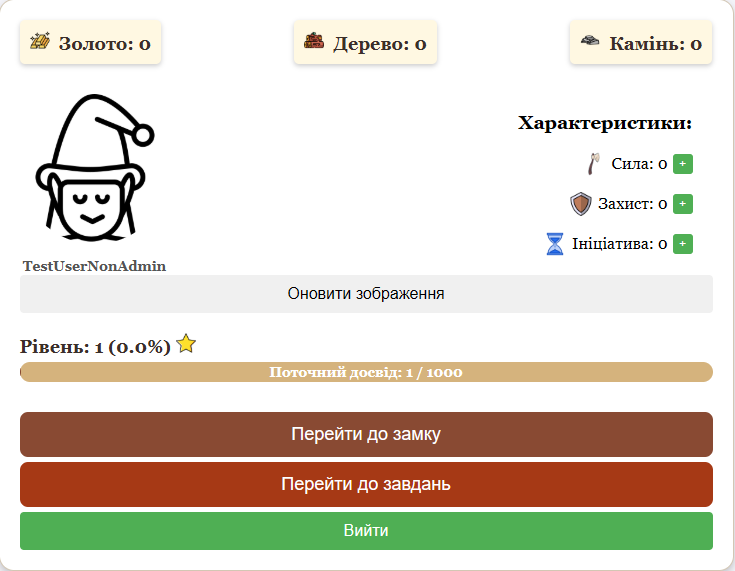
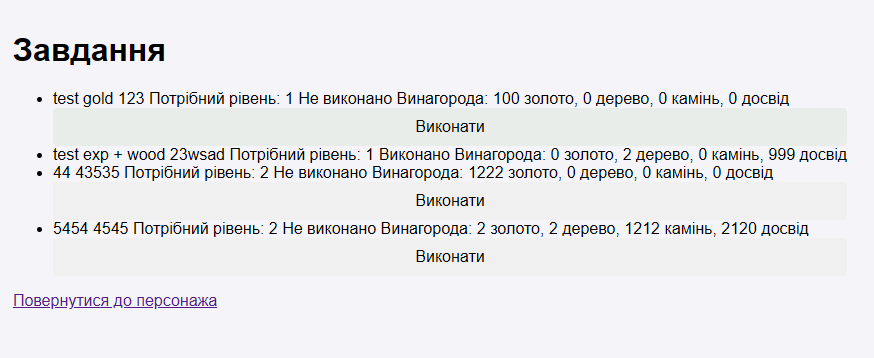
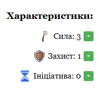
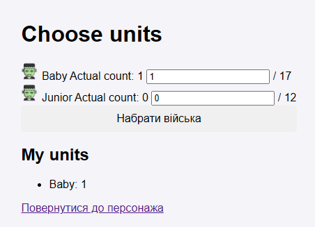

# browserStrategy

Some images for now

Main User Page after registr

Tasks for user via some rewards

Note: Just admin can add new tasks

User can update  characteristics as he wish

User cat choose some units related to user lvl

P.S. Ithis all just for myself)

## Міграції бази даних

Перед запуском версії з дошкою гільдії оновіть схему. Alembic використовує
`DATABASE_URL`, як і застосунок. Без цієї змінної ціллю є локальна
`backend/database/users.db`.

Для нової порожньої БД виконайте `alembic upgrade head`. Якщо БД уже має
повну схему проєкту з таблицями нового бойового рушія та ще не має історії
Alembic, зробіть резервну копію, перевірте відповідність схемі ревізії
`20261118_01` і виконайте `alembic stamp 20261118_01`, потім
`alembic upgrade head`. Команда `stamp` записує версію схеми. Для бази зі
старішою або частковою схемою спершу потрібно узгодити відмінності.

Для виконання квестів потрібні підприємства, які продають дерево та камінь.

### Редагування квестів гільдії

Шаблони зберігаються в [content/guild_quests.json](content/guild_quests.json).
Тут можна змінити назви, складність, цільовий ресурс, необхідну кількість,
мінімальний рівень гільдії та базові нагороди. Для вимкнення шаблону встановіть
`"enabled": false`. Ключ `key` має бути унікальним і сталим. Залишайте
щонайменше два активні шаблони збору ресурсів для першого рівня, щоб гравець
завжди міг замінити квест на інший.

Гра читає файл під час створення нових квестів. Перезапуск і міграція після
редагування не потрібні. У вже виданих квестів зберігаються початкові вимоги
та нагороди. Наразі генератор використовує категорію `collection`.
